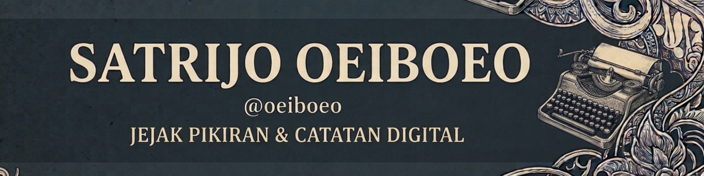

  

 

### 👋 Sugeng Rawuh! Saya Satrijo Oeiboeo (`@oeiboeo`)

> *"Jejak Pikiran & Catatan Digital — Klasik dalam ejaan, modern dalam kode."*

Saya adalah seorang penggiat teknologi, pengguna Linux, dan pembuat catatan digital. Nama **Satrijo Oeiboeo** adalah bentuk ejaan lama (Van Ophuijsen) dari nama asli saya, **Satrio Wibowo**, yang saya gunakan sebagai identitas berkarya di ruang digital.

---

### 🛠️ Lingkungan & Minat Utama

* **Sistem Operasi:** Debian GNU/Linux & ekosistem *open-source*
* **Fokus:** Pengembangan web, skrip otomatisasi terminal, dan catatan teknis
* **Sedang Dipelajari:** Eksplorasi perangkat lunak bebas (*FOSS*) dan arsitektur sistem modern

---

### 📫 Terhubung dengan Saya

* **Email:** [satrijo.oeiboeo@gmail.com](mailto:satrijo.oeiboeo@gmail.com)
* **YouTube:** [@oeiboeo](https://youtube.com/@oeiboeo)
* **X (Twitter):** [@oeiboeo](https://x.com/oeiboeo)
* **Facebook:** [Satrijo Oeiboeo](https://facebook.com/oeiboeo)

---

### 📜 Kebun Digital & Papan Eksplorasi

Ruang terbuka untuk membaca catatan teknis, panduan eksplorasi **Debian GNU/Linux**, serta memantau progres eksperimen perangkat lunak bebas (*FOSS*):

* **📚 [Arsip Jejak Pikiran & Catatan Digital](https://github.com/oeiboeo/catatan-digital)** — Kumpulan tulisan teknis, panduan `apt`, skrip otomatisasi Bash, dan kurasi aplikasi FOSS.
* **🗂️ [Papan Kerja & Peta Belajar (Projects)](https://github.com/oeiboeo?tab=projects)** — Papan Kanban terbuka untuk melacak gagasan, draf tulisan, dan eksperimen sistem yang sedang dikerjakan.

> *"Merawat catatan kecil hari ini sebagai kompas eksplorasi di masa mendatang."*

  <i>"Menulis kode seperti mengetik di atas mesin tik tua: teliti, terstruktur, dan bermakna."</i>

